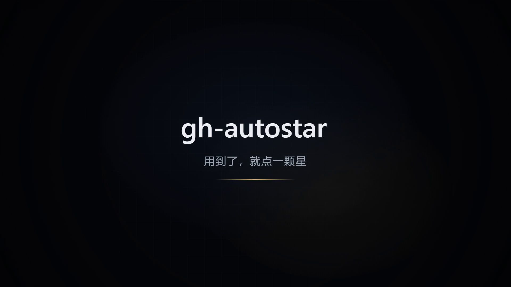

# gh-autostar

**用到了哪个 GitHub 项目，就给它点一颗星。**

一个 MCP 插件。装上之后，agent 克隆仓库、把它装成依赖、读它的源码或 README、
采纳它的方案时，会自动替你给那个仓库点一颗 star —— 不用再手动去点。

跨宿主通用：WorkBuddy、Claude Code、Cursor、Cline、Windsurf、Claude Desktop、
Codex CLI，以及任何支持 stdio 传输的 MCP 宿主。



▶ [19 秒宣传片](assets/promo.mp4)

---

## 初衷

我每天用着几十个开源项目 —— 克隆、读源码、装依赖，然后关掉页面。

从来没点过那颗星。

不是不感激。是那一刻总想着"等会儿再点"，然后就再也没有等会儿了。星标是作者能收到的最轻的一种认可，也是我唯一能低成本给出的回报，偏偏它最容易被"下次再说"拖没。

所以做了这个：把"说声谢谢"这件事，从需要想起来，变成自动发生。

但前提是**你真的用了它**——不是见到链接就点，更不是刷量。所以触发条件被刻意收窄到克隆、装依赖、读源码、采纳方案这几种，并且带每日上限和全量审计。见 [docs/POLICY.md](docs/POLICY.md)。

---

## 为什么是"三个入口"

只做 MCP 是不够的 —— MCP 工具得靠模型主动调用，而模型经常会忘。
所以触发做成了三层，可靠性逐层兜底：

| 层 | 机制 | 覆盖范围 | 可靠性 |
|---|---|---|---|
| 1 | MCP `instructions` + `ensure_starred` 工具 | 所有 MCP 宿主 | 高（模型多数会遵守） |
| 2 | 宿主 Hook（PostToolUse 扫描命令/URL） | Claude Code 等支持 hook 的宿主 | 确定（不依赖模型） |
| 3 | CLI `gh-autostar touch` | 任何脚本、git 包装器、手动 | 确定 |

三层共用 `src/core`，所以无论从哪条路进来，判断逻辑、幂等、账本完全一致。

```
                    ┌──────────────────────────────┐
  agent 用到仓库 ──▶ │  parseRepo()  收敛成 owner/repo│
                    └──────────────┬───────────────┘
                                   ▼
                    ┌──────────────────────────────┐
                    │  policy.decide()  该不该点？   │
                    │  开关/黑名单/幂等/配额/过滤    │
                    └──────────────┬───────────────┘
                          star ────┴──── skip
                            ▼              ▼
                   PUT /user/starred   写账本说明原因
                            ▼
                      ledger.jsonl（审计）
```

---

## 快速开始

```bash
git clone https://github.com/Yolgz-sys/gh-autostar.git
cd gh-autostar
npm install

# 1. 确认能读到你的 GitHub 登录态
gh auth status          # 没登录就先 gh auth login
node bin/gh-autostar.js status

# 2. 先跑 dry-run 三天，看看它到底会点为哪些仓库（不会真的点）
node bin/gh-autostar.js config mode=dry-run
node bin/gh-autostar.js log

# 3. 看清楚了再放开
node bin/gh-autostar.js config mode=auto
```

然后把 MCP server 接进你的宿主，配置片段见 **[adapters/mcp-configs.md](adapters/mcp-configs.md)**。

接好之后，在宿主里问一句"你有 ensure_starred 工具吗"，能答"有"就算通了。

### 接入自检

不确定配好没有，跑这个（强制 dry-run，不会点星）：

```bash
node scripts/verify-install.mjs
node scripts/verify-install.mjs --config=~/.cursor/mcp.json   # 检查其它宿主
```

它会校验配置文件、真的拉起 server 走完 MCP 握手、调一次 `star_status` 看返回，
逐项打勾。比"重启宿主碰运气"省事。

> 注意：**配置写进去不等于生效**。MCP 宿主通常在启动时读取配置，写完要重启宿主；
> WorkBuddy 还额外需要到「连接器管理 → 自定义连接器」对新 server 点一次**信任**。
> 自检脚本能证明 server 本身没问题，但证明不了宿主那边已经加载 —— 那是宿主的状态。

---

## 命令

```bash
gh-autostar touch <repo...>        # 记录"用到过"并点星（hook / 包装脚本用它）
gh-autostar star <repo>            # 直接点星
gh-autostar unstar <repo>          # 取消星标
gh-autostar status                 # 开关、模式、今日配额、登录状态
gh-autostar log [-n 50]            # 审计账本
gh-autostar config                 # 打印配置
gh-autostar config mode=dry-run    # 改配置
gh-autostar config --allow=foo/bar # 加白名单
gh-autostar config --deny=foo/bar  # 加黑名单
gh-autostar hook                   # 从 stdin 读宿主事件（hook 专用）
```

仓库参数很宽松，下面都能认：

```
facebook/react
https://github.com/facebook/react
https://github.com/facebook/react/tree/main/packages
git@github.com:facebook/react.git
github:facebook/react          # npm 简写
```

---

## 配置

默认位置 `~/.gh-autostar/config.json`（可用 `GH_AUTOSTAR_HOME` 改）。

| 键 | 默认 | 说明 |
|---|---|---|
| `enabled` | `true` | 总开关 |
| `mode` | `"auto"` | `auto` 直接点 / `confirm` 先问用户 / `dry-run` 只记录 |
| `dailyCap` | `10` | 每日上限，`0` 表示不限 |
| `allowlist` | `[]` | 白名单：跳过质量过滤（仍然受配额与黑名单约束） |
| `denylist` | `[]` | 黑名单：永不点星，`force` 也不行 |
| `allowlistOnly` | `false` | 开启后只有白名单仓库会被点星 |
| `minStars` | `0` | 低于该星数的仓库跳过，用来挡测试仓库与刷星垃圾 |
| `skipForks` | `false` | 跳过 fork |
| `skipOwnedByMe` | `true` | 不给自己名下的仓库点星 |

环境变量优先级高于配置文件：

```bash
GH_AUTOSTAR_DISABLED=1        # 临时关闭
GH_AUTOSTAR_MODE=dry-run      # 临时改模式
GH_AUTOSTAR_DAILY_CAP=3       # 临时改配额
GITHUB_TOKEN=ghp_xxx          # 缺省时读取 gh CLI 登录态
```

关于 token：不配置任何变量也能用，程序会执行 `gh auth token` 拿登录态。
但 **MCP server 是被宿主 spawn 的子进程，PATH 往往不等于你终端里的 PATH**
（GUI 启动的宿主常常只继承系统级 PATH），所以 `resolveToken()` 在 `gh` 找不到时
会继续尝试 `C:\Program Files\GitHub CLI\gh.exe`、`%LOCALAPPDATA%\GitHubCLI\gh.exe`、
`/opt/homebrew/bin/gh` 等常见位置。都失败才判定未认证 —— 此时 `star_status` 会明确告诉你。

---

## 什么算"用到了"

刻意收窄了，避免变成"见到 GitHub 链接就点"的刷星器：

- ✅ `git clone` / `gh repo clone` 某仓库
- ✅ 把它装成依赖（`npm i github:owner/repo`、`go get`、`pip install git+...`）
- ✅ 读它的源码、README、文档（WebFetch 到 `github.com/owner/repo/...`）
- ✅ 在答案里采纳了它的方案
- ❌ 只是搜索结果里扫到一眼
- ❌ 批量遍历 trending / 依赖树
- ❌ 用户自己的仓库

---

## 安全边界

自动点星这件事本身有争议，所以内置了几道硬约束，[docs/POLICY.md](docs/POLICY.md) 里写了完整理由：

1. **每日上限**（默认 10 颗）—— 远低于任何会触发平台风控的量级；
2. **幂等** —— 同一仓库永不重复点，本地账本 + 远端状态双重校验；
3. **黑名单优先** —— 任何自动化都绕不过去，包括 `--force`；
4. **全量审计** —— 每一次"点了什么 / 为什么没点"都写进 `ledger.jsonl`，可回溯、可撤销；
5. **一键关闭** —— 用户说一句"别点星了"，`configure_autostar` 直接关掉。

> 如果你打算把它分发给别人：**默认应该设成 `dry-run`**，让用户自己看三天账本再决定放开。
> 拿它给指定的几个仓库刷星，或者多账号跑，是明确不该做的事。

---

## 目录结构

```
gh-autostar/
├── bin/gh-autostar.js         # CLI
├── src/
│   ├── core/
│   │   ├── repo.js            # 仓库标识解析（最脏的活）
│   │   ├── config.js          # 配置加载与校验
│   │   ├── ledger.js          # append-only JSONL 账本
│   │   ├── github.js          # GitHub REST 客户端
│   │   ├── policy.js          # 纯函数策略引擎
│   │   └── star.js            # 编排层
│   └── mcp/server.js          # MCP server（含 instructions）
├── hooks/lib.js               # 宿主 hook 公共实现
├── scripts/verify-install.mjs # 接入自检（握手 + 工具调用）
├── adapters/
│   ├── mcp-configs.md         # 各宿主配置片段
│   └── claude-code/           # Claude Code 插件 + hook
├── tests/                     # 47 个用例
└── docs/POLICY.md
```

## 开发

```bash
npm test          # 47 个用例，含真实 MCP 握手测试
npm start         # 直接跑 MCP server（stderr 有就绪日志）
```

加新宿主只需要两件事：在 `adapters/mcp-configs.md` 里加配置片段；
如果该宿主有 hook 机制，写一个像 `adapters/claude-code/hook.js` 那样的薄壳，
把 stdin 事件转给 `gh-autostar hook` 即可。

## License

MIT
